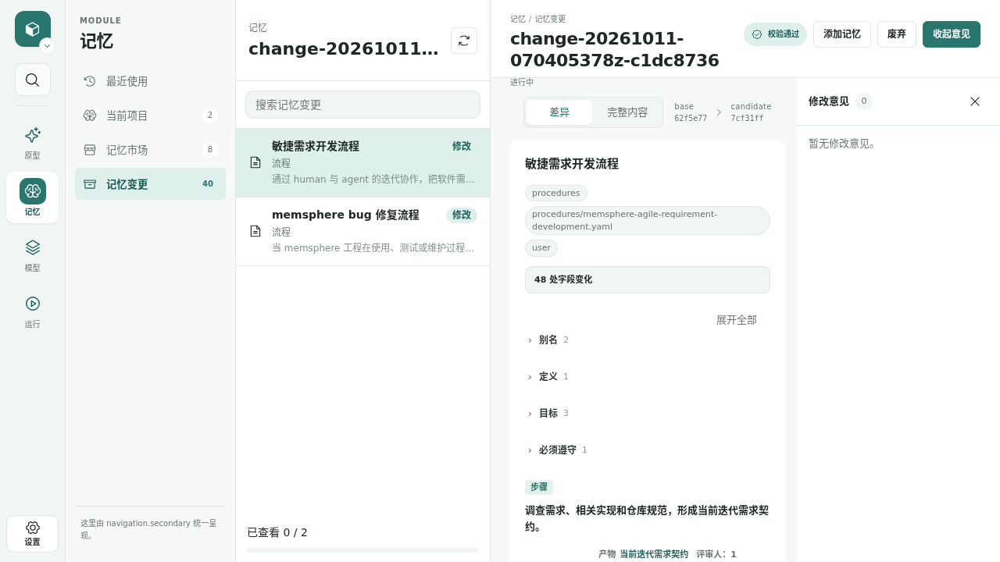
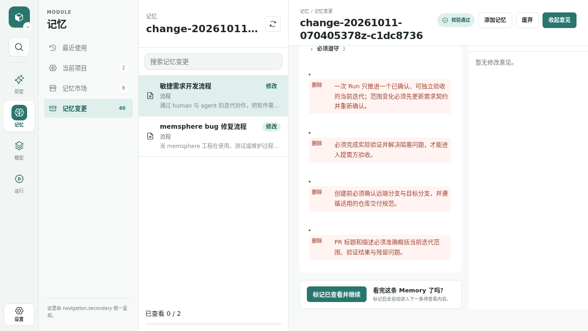
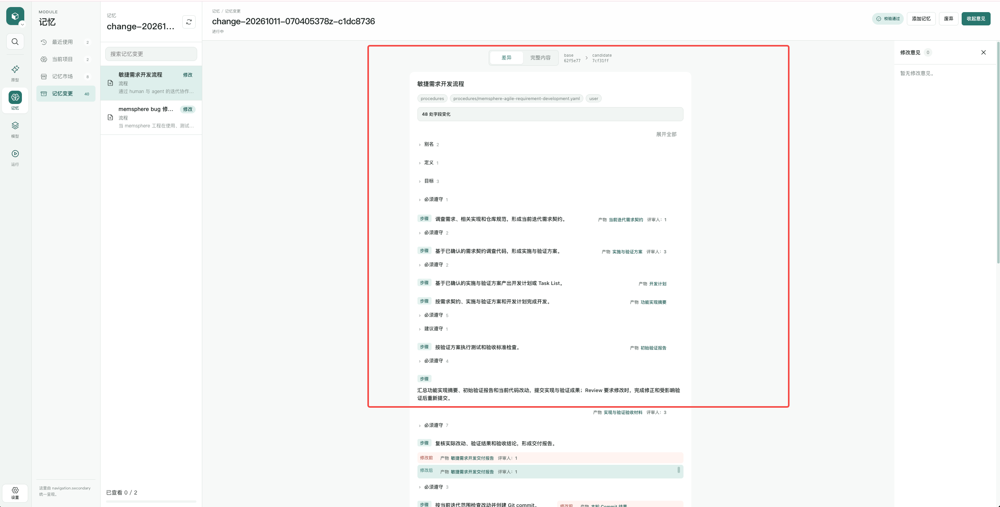
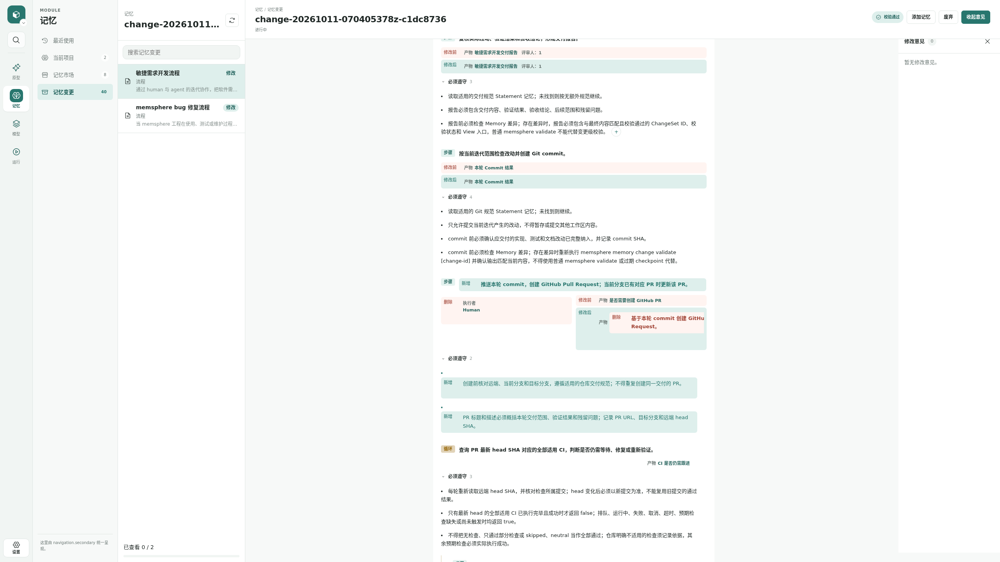
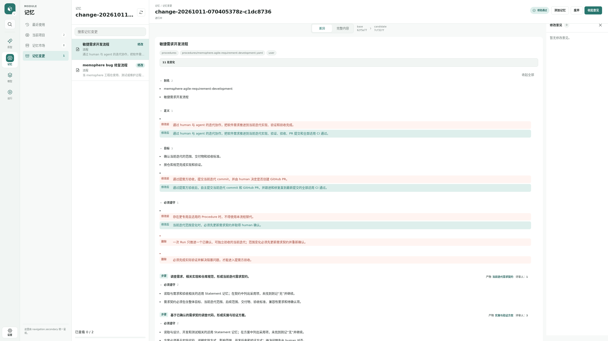
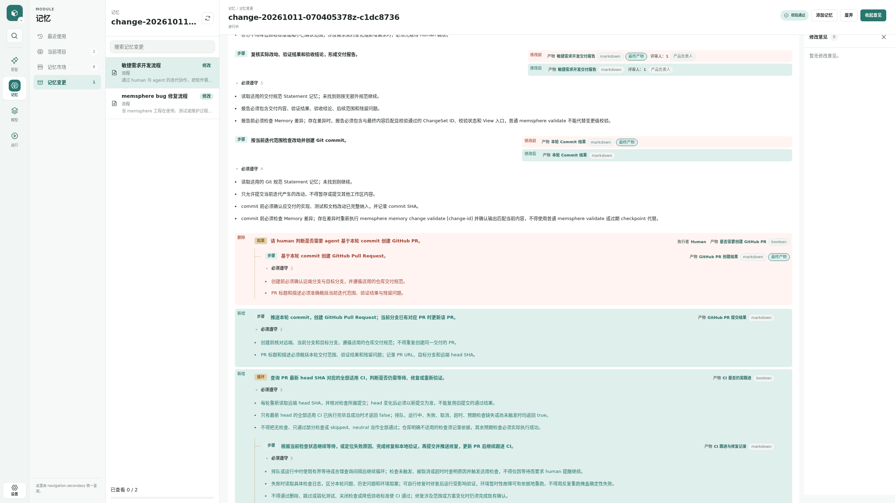
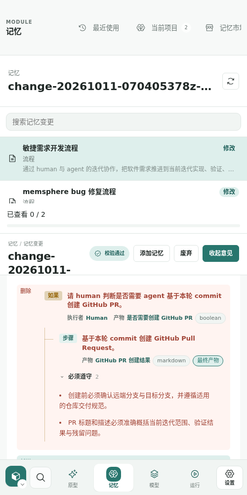
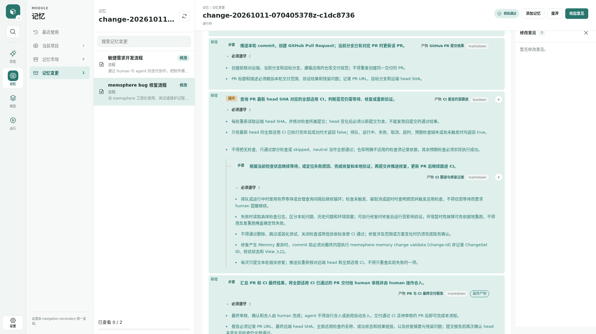

# ChangeSet 差异渲染与大屏布局修复

## 需求

修复 ChangeSet 差异审阅中结构错乱、变化漏显和正文限宽问题，使审阅人能够准确理解 Memory 的增删改，并在大屏上利用可用空间审阅。用户额外参与“产品负责人”角色，与已有产品 Agent 一起评审需求契约与最终交付报告。

[敏捷开发 Run](/projects/memsphere/tasks/run-20261011-145951z-7d728b98)。产品负责人绑定 `traex1`（产品 Agent）与 `actor5`（billtenor），研发、架构、测试使用已有对应 Agent；各评审采用 unanimous policy。

### 复现入口与步骤

- Project：`memsphere`。
- ChangeSet：`change-20261011-070405378z-c1dc8736`。
- [原始页面](/projects/memsphere/changes/change-20261011-070405378z-c1dc8736?section=changes)。
- 默认“差异”模式下，分别选择“敏捷需求开发流程”和“memsphere bug 修复流程”，点击“展开全部”，查看 PR 分支、CI 循环及文档末尾；切换“完整内容”核对候选结构。
- 大屏复现使用 2560×1440 CSS viewport；另有用户提供的原始 2556×1297 截图。浏览器 viewport 与物理屏幕像素并不等价，验证时记录实际 CSS viewport。

### 问题一：差异渲染错乱

2026-10-11 使用 playwright-cli 操作真实页面，并对照只读 ChangeSet API 的 baseMemory 与 memory，确认：

1. 删除的顶层规则和旧 PR 分支规则脱离原来的列表及层级，出现在整个流程末尾。
2. 原第九步 `!if` 改为直接提交 PR 的 `!action` 后，旧分支被拆成执行者、产物、子步骤的零散删除；旧条件“请 human 判断是否需要 agent 基于本轮 commit 创建 GitHub PR。”漏显示。
3. 新增 CI `!while` 的条件、产物与约束没有完整表达新增状态，循环内部步骤却标记为新增。
4. “敏捷需求开发交付报告”和“本轮 Commit 结果”删除了 `final: true`，默认视图中的修改前后却近似相同，实际变化隐藏在产物悬浮详情中。
5. 删除内容仍保留“添加评论”按钮与旧锚点，如 `procedure.flow[9].then[1].action`；候选中已无该位置。已确认 DOM 保留按钮和旧锚点，未向线上 ChangeSet 提交测试评论。

初步原因：`modules/org.memsphere.memory/adapter/view/index.ts` 通过标量差异修改已有 DOM；结构数组按下标匹配，`tag` 被忽略；条件字段的渲染锚点与真实 `.condition` 数据路径不一致；删除位置依赖相同路径寻找邻居并在找不到合适容器时追加到文档末尾。具体修复方式在实施与验证方案中确定。

### 问题二：大屏正文限宽

外层可用空间能够扩展，但 `.memory-change-main` 使用 `width:100%; max-width:720px; margin-inline:auto`，收起意见面板也只放宽到 `960px`。大屏上正文保持窄列，出现大面积空白，长步骤和嵌套差异频繁换行。期望审阅主体随剩余可用空间伸展，保留适量边距；如需限制单段文字行长，应局部处理，不应限死整个流程与差异容器。

### 截图证据

截图均为修复前；用户红框只用于标出正文与留白区域。

## 验收标准

1. 在上述两条 Memory 的差异中，新增、删除与修改内容均位于正确的节点、列表与父级上下文中；删除规则不得作为无归属内容追加到流程末尾。
2. `!if` → `!action` 等节点类型变化完整展示旧结构与新结构，包含条件文本、执行者、产物、分支与规则，不漏显或跨节点混拼。
3. 新增或删除的整个控制节点及其条件、产物、约束、子节点具有一致且明确的增删表达；颜色之外提供文字标识。
4. 结构列表中插入、删除节点后，后续未改变节点不因下标移动而误判为修改；嵌套分支同样验证。
5. `final`、产物类型、格式、评审人等实际发生变化的元数据，在差异模式中直接可见，无需依赖悬浮才能判断；未变化信息不制造虚假变化。
6. 评论绑定语义明确且测试覆盖：候选内容继续可评论；基线专属或已删除内容不得误绑定到候选锚点。是否提供独立的基线评论能力在方案中明确，不能沿用无效路径。
7. 在 1280、1920、2560 CSS 像素宽度及窄屏验证布局；大屏正文随可用空间变宽，不再受 720/960px 固定上限限制。收起意见面板、调整 Shell 列宽后正文利用释放的空间；窄屏无页面级横向溢出。
8. 差异/完整内容切换、展开/收起、已有评论和已查看操作保持可用，中英文与主题样式无回归。
9. 针对本次结构与布局风险补充自动化回归测试，用 playwright-cli 操作真实 Shell；通过受影响测试、npm run typecheck、npm test、npm run build、memsphere validate。若修改 Memory，另行执行变更级 validate 并记录证据。
10. 产品负责人参与需求和交付评审；验收中提供修复后的同场景截图，与修复前证据对照。

## 范围

- ChangeSet Memory 差异的结构匹配、渲染、元数据可见性与评论锚点。
- ChangeSet 正文的响应式宽度及意见面板收起状态。
- 自动化回归、真实页面验证、修复前后截图；必要的 Memory/Skill 契约同步。

## 不做事项

- 不修改作为复现样本的线上 ChangeSet 内容，不提交测试评论。
- 不增加 Memory 原始 YAML 编辑器或任意版本通用比较工具。
- 不扩展成整个 Shell、普通 Memory 阅读页或其他 Module 的布局改造。
- 不混入样本 ChangeSet 中的敏捷流程/bug 修复流程业务修改。

## 向前兼容

结论：不需要向前兼容。

本轮修复展示与定位正确性，不新增 YAML syntax 或持久化数据格式；当前仓库 `git tag -l '*stable*'` 无输出，无需承担额外 stable checkpoint 的迁移兼容责任。现有 ChangeSet、Memory 与评论数据须继续读取；若方案涉及协议或数据模型变化，重新明确兼容结论并提交评审。

## 关联需求

- `20260828-changeset-diff-review`：强关联，原差异审阅能力需求；其文档仍为 todo，但实际页面已有差异模式。本记录专门跟踪已复现的实现缺陷与大屏布局问题，不宣称原需求已完整验收。
- 重复缺陷记录：未发现同一复现问题的独立记录。

## 技术与测试方案

实施与验证方案已在关联 Run 中接受。核心实现为前端结构差异计划：保留顺序的节点配对与独立前后路径，节点类型改变及整个节点增删使用完整结构；删除项依差异序列定位在对应父级和原步骤槽位。条件内容统一使用真实 `.condition` 路径；旧内容由无评论回调的 renderer 生成并保留展开交互，变化产物元数据直接可见。正文取消固定最大宽度，并处理窄屏网格及元数据换行。

不新增 API、持久化字段或 YAML syntax。重排用增删表达。Framework System Memory、当前 worktree 副本和 Skill 已同步差异审阅与基线只读评论边界。

## 开发任务

开发计划、功能实现摘要已由关联 Run 上报；实现和回归测试已完成，当前处于验证及验收阶段。研发/架构/测试实现验收与产品负责人交付评审均已通过。

## 验收结果

已完成修复前复现、API 对照、修复和真实 Shell 操作。受影响浏览器/算法回归 13/13 通过，Reserved Store 联合回归通过，typecheck、build、memsphere validate 通过。最终代码顺序执行全量 142 文件无失败（297.16s）；typecheck、build、Store validate、Memory change validate 和 diff check 全部通过。中间一次并行 build 清理 dist 造成两项 CLI 测试 ENOENT，改为顺序执行后全部通过，未修改产品代码规避失败。正式实现和产品交付评审均已通过。

真实 View 使用隔离 Home 和复制的原 ChangeSet 记录，不替换线上服务或修改原 ChangeSet。最终窄屏修复后，CSS viewport 2560/1920/1280/500 时正文宽度分别为 1634/994/354/472px，scrollWidth 等于 clientWidth。基线内容评论按钮为 0，旧 human PR 条件与子分支完整可见，删除规则属于原 `procedure.asserts`。

修复后截图：

真实 Shell 操作另已验证差异/完整内容切换、展开全部、切换两条 Memory，以及在新增循环的候选条件锚点打开并取消评论编辑器；未提交测试评论。浏览器控制台无错误或警告。

Memory 变更校验通过：`change-20261011-151405577z-6bb5b6eb`；digest 为 `1c265e85efddd72b2b4e334bcc807cbea7ef453b0d2516846ad22892a67e590d`；[变更入口](/projects/memsphere/changes/change-20261011-151405577z-6bb5b6eb)。

第一步“当前迭代需求契约”评审 `review-20261011-150030z-1ae3fe55` 第 1 轮已通过。billtenor 在对话中明确“我投票通过”，Runner 代提交 approve（无 Comment）。产品 Agent 对默认流程选择的建议已记录为 rejected-invalid：本次用户明确指定敏捷迭代流程，仍保留根因、测试缺口及回归验证。未修改用户投票或跳过后续评审。

第二步“实施与验证方案”评审 `review-20261011-150447z-98cf19ca` 第 1 轮已由 Runner 接受；三份建议都针对同一流程选择问题，均记录用户明确指定流程及前序通过票的处理依据。实现摘要和最终初始验证报告已提交；第六步“实现与验证验收材料”评审为：`review-20261011-153502z-867340c0`，第1轮。后续继续同一个 Run，不另起流程。

第六步实现评审 `review-20261011-153502z-867340c0` 第1轮：研发、测试、架构均approve，Runner已接受；各Agent亲自检查实际代码并复跑受影响13项测试。第七步产品交付评审已提交：`review-20261011-154006z-6de7cda8`，round `round-20261011-154006z-574e62b0`；billtenor assignment `assignment-20261011-154006z-a3855e15`，2026-10-12用户查看当前修复代码View后明确“验收通过”，Runner代提交approve（0条Comment）；产品Agent亦approve，Runner已接受交付成果。

最终验收：本需求所有验收标准已完成验证，用户产品负责人正式通过；需求及8张证据截图于2026-10-12归档完成。下一步只提交本迭代改动，是否创建PR由当前Run后续Human步骤决定。
