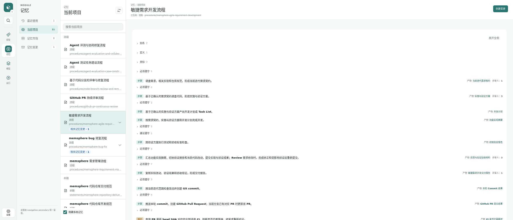
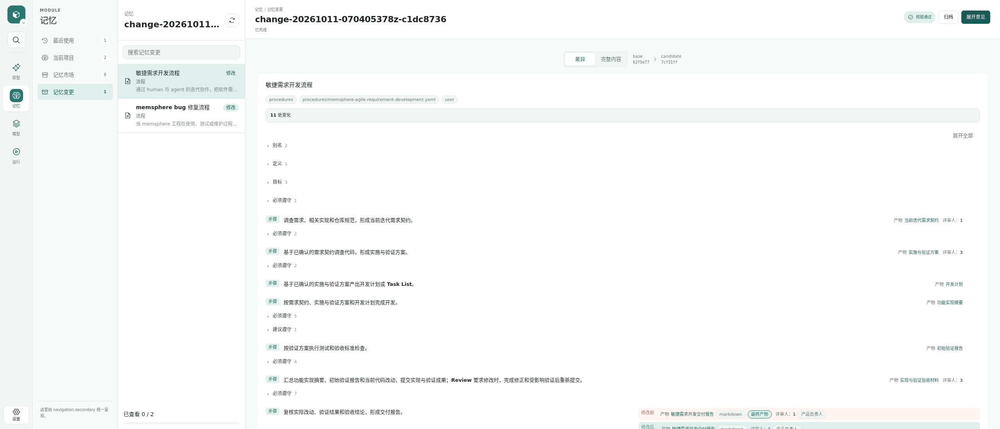
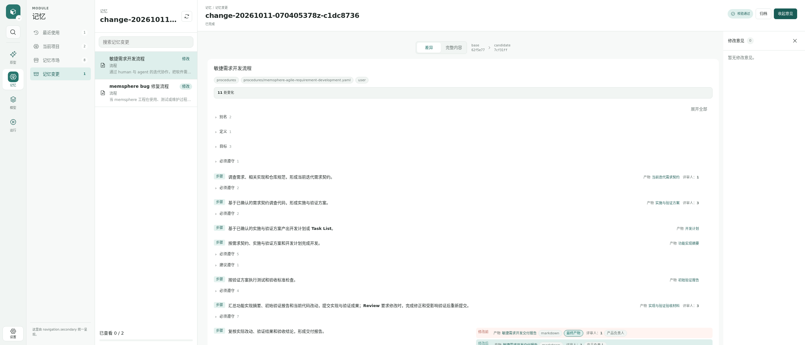
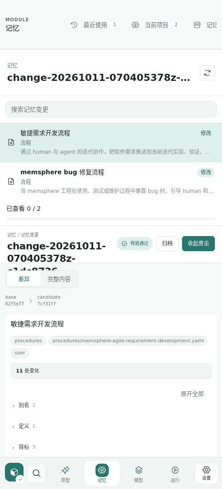
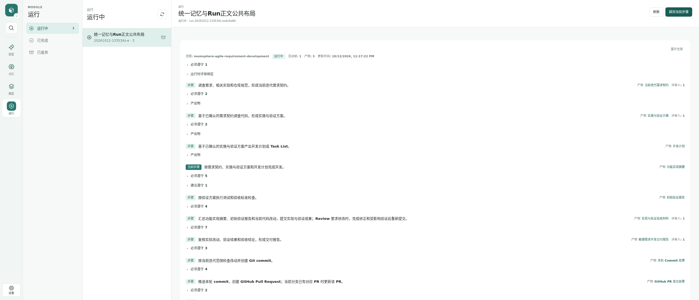
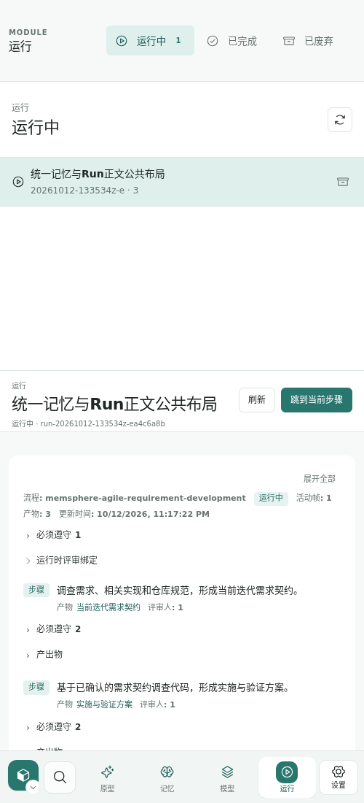
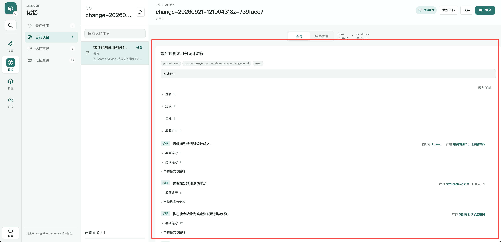
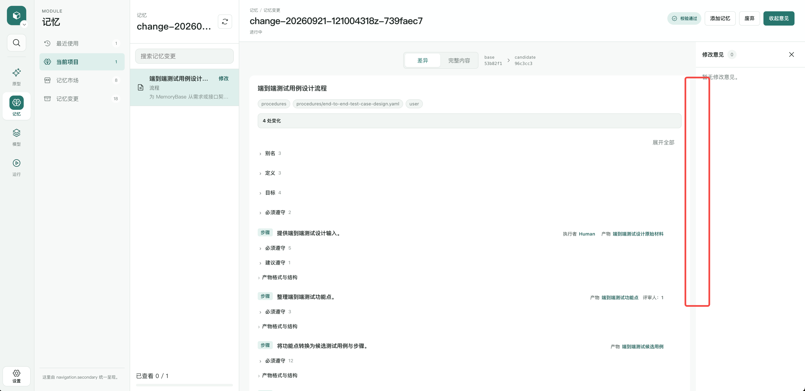

# Memory、ChangeSet 与 Run 共用正文布局

## 需求

整体目标：正文随 Shell 剩余空间伸展，同时具有清楚且一致的两侧留白。用户指出上一轮仅放宽 ChangeSet，Memory 本身与 Run 仍然窄列；修复应通过公共显示框架让三个入口一起受益。

本轮范围：Memory 普通详情（四种类型）、ChangeSet 差异与完整内容（展开/收起意见）、Run 详情与步骤产物，统一正文宽度及水平边距的公共实现；维护现有内容层级、侧栏交互、主题扩展覆盖和响应式行为。公共框架负责可用空间及页面边距，领域模块负责内部内容。上一轮未提交的 ChangeSet 右侧留白修复及其回归断言纳入本轮重构。

交付物：公共布局代码与三个页面接入、浏览器回归、实际 Shell 操作截图、规范说明同步、验证与 Agent 评审记录。

后续范围：其他模块是否采用该布局可单独评估；本轮不改 Settings、Models、Reference 的领域布局，不改持久化、DSL 或评审浮窗的业务行为。

已确认设计：2026-10-12 用户明确要求公共样式可通过 Slot 修改、各官方页面布局可分别通过 Slot 修改，同时减少叠加层次。保留既有 `styles.global@1`、`org.memsphere.memory.page.presentation@1:page`（含 ChangeSet）与 `org.memsphere.run.page.presentation@1:page`；不增加 `content.workspace` 或新的公共 UI API。官方页面入口负责内部画布组织，共用一套基础布局代码与公开可覆盖的样式入口，公共样式选择一次同时影响三个页面。已有 content.document/flow/disclosure 继续负责内部内容，不扩大职责。

待确认项：无。用户本轮明确确认以上设计约束，撤回先前拟新增 Slot 范围。中间评审全部由 Agent 承担；最终交付报告评审通过后暂停在 Git commit 前，请用户查看效果并验收，未获得验收前不 commit/push/创建 PR。

采用规范：memsphere-repository-requirement-rules（兼容性决策）、development-rules（避免过度设计、System Memory 与 Skill 同步）、testing-rules（受影响及全量测试、typecheck/build/Store validate、真实 Shell 操作）、delivery-rules（最终验收前不归档为完成）。

## 验收标准

1. Memory 四类详情、Run 详情及 ChangeSet 共享同一页面宽度和水平边距实现，不再各自硬编码 720/960/972/980px 最大宽度；避免以公共 CSS 覆盖残留限宽代替接入。
2. 1920 与 2560 CSS 像素宽度下，各正文跟随可用详情区域扩展；拖动 Shell 列宽后重新利用剩余空间。没有整体窄列及大面积无用途空白。
3. Memory、Run、收起意见的 ChangeSet 两侧留白一致；展开意见时正文与意见栏有清楚间隔，意见栏保持可用，收起不丢失右侧留白。
4. 1280、821、820 与 500px 布局无页面级横向溢出，不出现重复边距挤压；长流程、嵌套规则和元数据可换行。820/821 作为成对边界验证。
5. 切换 Memory、ChangeSet 差异/完整内容、意见开关、Run 步骤/产物仍可用，验证明暗主题及英文/中文页面。
6. 公共实现消费公开 Theme Token，保持 View Package 样式可覆盖，不读取 Shell 私有 selector 或 Token；不全局强制改造任意第三方模块。
7. 受影响浏览器回归、npm run typecheck、npm test、npm run build、memsphere validate 通过；Memory 修改须有最终 change validate 证据。实际 Shell 截图及浏览器控制台检查有记录。
8. 四角色 Agent 完成对应评审，最终用户验收前停在 commit 前，不代替用户验收、不声称需求完成。
9. 使用现有 styles.global 选择一份公共布局样式即可同时影响 Memory、ChangeSet、Run；两个既有 page.presentation 可以分别替换官方详情页布局。验证实际扩展选择、全局样式覆盖、独立页面替换及回退；不新增配置位置，不要求用户维护新的容器 Slot。

## 向前兼容

结论：不需要向前兼容。当前仓库没有名称包含 stable 的 Tag；本轮为展示布局调整，无数据、协议或 DSL 迁移。已有 Memory、Run、ChangeSet 保持可读；公开主题及样式扩展的覆盖能力保留。

## 关联需求

20261011-changeset-diff-layout-fix：强关联，该已完成需求仅放宽 ChangeSet，本轮补齐普通 Memory 与 Run 并统一公共实现。20260902-view-framework-standardization 与 20260902-view-common-controls-standardization：公共框架相关背景。未找到同范围 active 重复需求。

## 技术与测试方案

方案已完成两轮 Agent 评审。用户最终确认不新增 Slot，由既有 page.presentation 负责具体布局、styles.global 负责公共样式。第三轮方案已由研发、测试、架构 Agent 全部通过，Runner 接受。使用现有 main 元素、共享样式属性和 CSS，page.presentation 维护内部画布排列；窄详情区按容器宽度堆叠意见。补齐 820/821 成对边界及真实扩展覆盖/页面替换验证。

## 开发任务

共享布局、页面接入、文档与 Memory 同步、浏览器与真实 Shell 验证、全量检查及 Agent 评审按已接受第三轮方案推进。

## 验收结果

共享布局与两个官方页面入口接入已完成，未新增 Slot/API/配置项。受影响浏览器与Reserved Store回归65项通过，公共样式选择及独立page.presentation替换验证通过；额外Theme Token覆盖验证通过。真实Shell用当前worktree构建和隔离Home，Memory与Run在2560px时详情区域1932px，ChangeSet正文收起1868/展开1626px；拖动Shell列宽后正文同步伸缩，821/820/500px均无页面横向溢出。窄详情区意见堆叠，按钮/标签/字段标题可换行。

全量回归143/143文件通过（0失败，310.05s），typecheck、build、Store validate、最终Memory change validate及diff check通过。实现验收已提交研发/测试/架构Agent：review-20261012-153950z-aff3f6d5，第1轮，研发、测试、架构均通过，Runner接受。产品交付评审 review-20261012-154440z-55b3257d 第1轮产品Agent通过，Runner已接受。研发/测试/架构/产品四角色评审全部通过。唯一卫生问题node_modules临时符号链接已移除，git status无该项、staged diff为空、diff check通过；产品轮意见comment-20261012-154913z-8575c94b已记录accepted-fixed，前一实现轮只读不改写历史。2026-10-12 在展示记忆/ChangeSet/Run效果并停在用户最终验收点后，用户明确回复“好，请继续流程”，本轮最终验收通过并授权继续同一Run提交、PR和CI。当前进入“本轮Commit结果”，需求按交付规范归档completed；PR/CI继续由Run跟进，不以尚未执行的检查作为成功证据。

修复后证据：

实际尺寸及交互结果：assets/real-shell-evidence.json。Memory验证：change-20261012-134215362z-d42aa792，digest 1b855da5c7d0ddac4495b3a782eb25b0b91dd3223ec2ad270488f3daeb22cf8f，通过；View入口 /projects/memsphere/changes/change-20261012-134215362z-d42aa792。两份源与安装副本一致。

用户原始截图：

