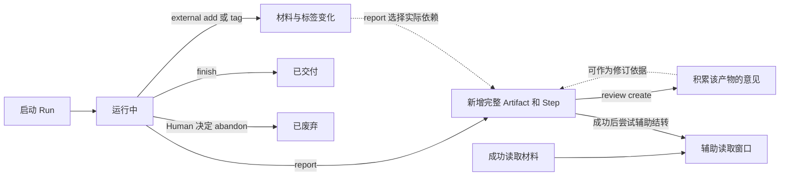

# CLI 与状态流转设计

本文定义自由探索的业务状态、命令及输出契约。存储结构见 CommandState 模型设计；页面交互见依赖图展示与交互设计。本轮不接旧流程、Schema、正式 Review、ChangeSet、ACP或Runner启动器。

## 五组状态

| 状态组 | 持续变化的事实 | 触发操作 |
| --- | --- | --- |
| 运行 | 未启动、运行中、已交付或已废弃 | start、finish、abandon |
| 产物 | Step完成、新产物提交、依赖及修订图扩展；旧产物保留；成果随图推导变化；人工增删单独保存 | report、outputs update |
| 反馈 | 某份产物的Review及意见从无到有、持续积累 | review create；修订依据由执行者判断 |
| 材料 | External登记、被产物引用、Artifact标签集合变化 | external add、artifact tag、report固化实际引用 |
| 读取窗口 | 真实读取积累、上一份成功产物更新；异常时可不完整 | 普通读取辅助记账、成功report后辅助CAS |

状态不限于status字段；这些状态也不是五个必须依次走完的阶段。

report可直接生产新成果，也可修订旧成果，不要求先Review。轻量Review只记录意见，不引入待审批、通过／退回等正式门禁；有意见不代表必须修改。

## Continue 的命令契约

run start成功时自动生成前文ID，回执含contextId及continue C --help提示；run status找回原有记录，不查询一次创建一次。普通Agent显式传C，跨Shell沿用；本轮不识别环境默认ID。

| Continue子命令 | 自动承接 | 每次显式提供 |
| --- | --- | --- |
| report | 项目、Run | 正文或文件、名称；可选依赖、标签、修订来源及内容类型 |
| review create | 项目、Run | Artifact ID、reviewer来源、评论（可重复）或文件 |
| external add | 项目、Run | source与content，或结构化file |
| artifact tag | 项目、Run | Artifact ID及标签 |
| outputs update | 项目、Run | --add／--remove Artifact ID，均可重复 |
| finish | 项目、Run | 交付Artifact ID，可多份 |
| abandon | 项目、Run | 原有可选原因；必须已有Human明确废弃指示 |

查询与读取仍使用普通命令：run status/show、artifact show/impact、external show、review list/show、outputs list。它们按原方式明确定位材料，不为方便复制成另一组Continue子命令。原生完整业务写命令也保留。

普通自由探索移除artifact create、report的预建target路径及读取--for。完整内容准备好后直接report，系统创建对应Step。Schema草稿及旧流程命令不受影响。

Continue帮助从真实业务状态计算可执行命令；结束后不再提供生产操作。前文只承接公共定位，不自动把上一份产物当作评审、修订或交付对象。显式参数与绑定矛盾、未知命令／前文／项目、旧Run类型均明确处理，不能静默换一个运行。

## 产物与依赖

提交后内容和依赖不原地修改；修订创建新Artifact，revisedFrom仅表示修订来源，dependencies表示实际生产依赖。A变为A′不会自动改绑旧B，重新生产B′时显式引用A′。

修订省略依赖时继承被修订产物的依赖；显式依赖替换完整集合。按tag上报时固定为当次实际Artifact ID，不追随未来标签。回到旧成果重走继续使用report，不增加rewind命令。

## 当前成果的推导与命令

Run只记录outputOverrides中的人工添加与移除。自动成果取完整submitted产物中没有实际下游且未被修订替换的产物；实际成果＝（自动成果∪人工添加）－人工移除。External、草稿和未完成Step不进入成果根。Snapshot.outputArtifactIds是查询结果，不是Run的持久化字段。

report只保存Artifact并完成Step，redo也只完成原Step；两者均不更新Run。读取在必要redo后按同一Snapshot推导成果。未完成提交若无法恢复，仍明确RECOVERY_REQUIRED，不返回不完整图。

| 操作 | 完整命令示例 | 规则 |
| --- | --- | --- |
| 查看 | memsphere --project memsphere run outputs list --run R | 普通查询；返回推导成果的ID、名称、状态，不返回整个闭包 |
| 移出 | memsphere --project memsphere run outputs update --run R --remove A --remove B | 只记录人工移除并取消对应人工添加；记录和依赖保留 |
| 加入 | memsphere --project memsphere run outputs update --run R --add A --add B | 记录人工保留并取消对应人工移除；后续被依赖或修订也保留，直到手动移除 |
| 替换 | memsphere --project memsphere run outputs update --run R --remove A --add A2 | 一次CAS保存人工调整，回执返回推导后的完整根列表 |
| 承接更新 | memsphere continue C outputs update --remove A | 承接项目和Run；list仍是普通查询 |

add／remove可重复，至少一项；同一ID同时加入和移除则拒绝，未知或跨Run对象拒绝，加入草稿或未完成产物拒绝。先验证全部输入，一次更新；重复相同人工调整幂等。允许清空，终态禁止修改。移出的产物作为其他成果的依赖时仍展示；新修订ID不继承旧ID的隐藏选择。

finish仍显式确认交付ID，在结束更新中保存相对自动成果的增删差值，不存完整outputs，也没有另一份finalArtifactIds。结束后输入图和人工调整均固定，成果可稳定推导。

## 读取及输出

| 情况 | 规则 |
| --- | --- |
| 正文≤200 chars | 完整预览 |
| 正文>200 chars | 前200个Unicode字符后追加...；按chars而非bytes，英文字母、汉字各算一个 |
| 文本输出 | 正文在stdout，截断说明和具体完整导出命令与正文分开 |
| JSON输出 | 单一合法JSON；正文为content字符串，使用truncated和exportCommand表达提示，不在JSON后加纯文本 |
| --out | 完整原始字节，目标独占创建，不混入提示，不重复回显正文 |
| 非文本材料 | 类型及导出提示，不回显二进制 |

external add的成功回执只返回runId、externalId；完整来源及正文保存在Store，需要时普通读取。网页完整内容不受CLI的200 chars限制。本轮不增加阈值配置、自动摘要或新的分页读取协议。

辅助窗口不决定真实依赖。能可靠归属才记账，识别不了正常读取并跳过；正常路径有未覆盖候选必提醒。具体字段、CAS及降级边界统一见CommandState模型设计，不在这里重复定义。
